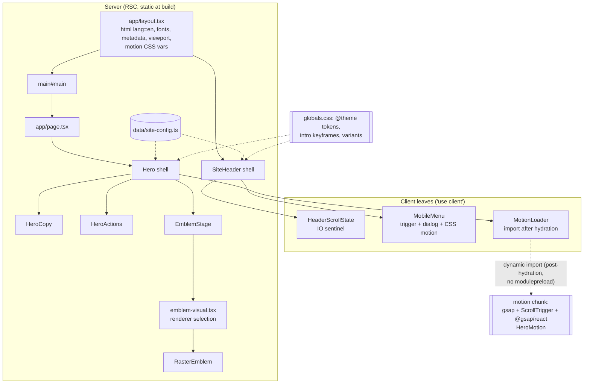
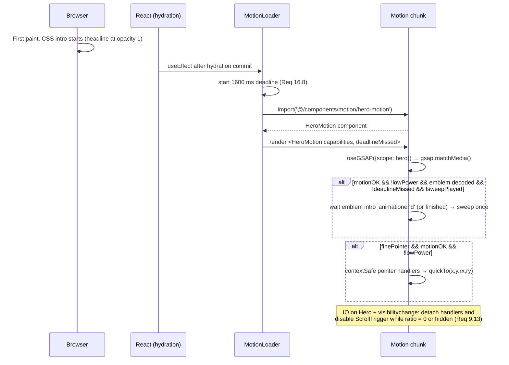
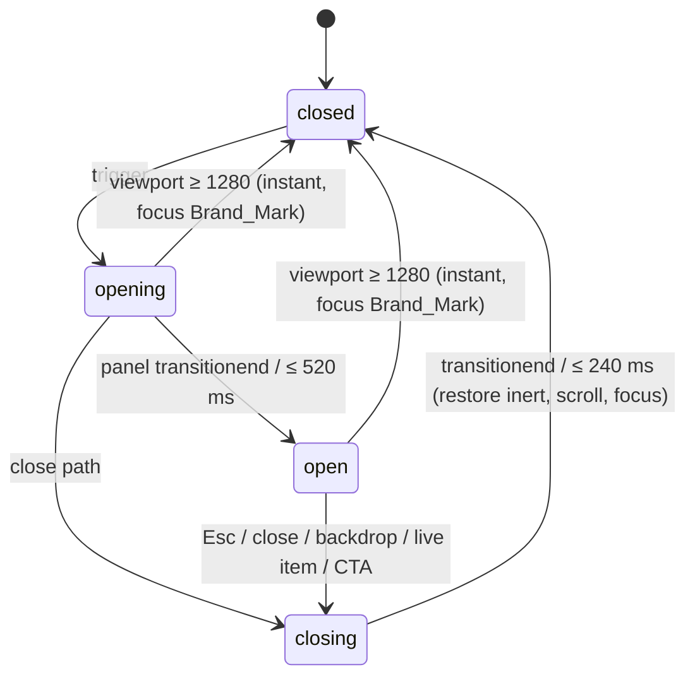
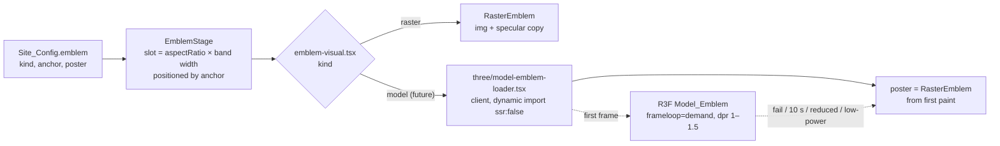

# Design Document: Cinematic Hero

## Overview

This design covers the PEYMAN homepage hero and the Site_Header that will become global navigation. It is the first feature of the site and sets the visual, typographic, motion, accessibility and performance language that later sections (Advisory, Industries, Intelligence, Insights, About, Contact) inherit.

PEYMAN is an institutional advisory firm for the capital and technology economy, not a conventional law firm. The hero must say one thing in the first two seconds: serious people who help ambitious businesses navigate capital, law, government and complex transactions. The tone is calm, precise, expensive, intelligent, confident, modern and discreet.

`requirements.md` was not modified. Where this design departs from it, the change is listed in [Requirements deltas](#requirements-deltas) and needs owner approval before implementation.

### Design philosophy

1. **The headline carries the brand; the emblem gives it gravity.** The typography does the work of luxury. The emblem is a lit object on a stage, not decoration.
2. **Nothing performs.** Motion shows how the page is assembled, then stops. After about 2.4 s the page is still unless the visitor moves.
3. **Architecture, not ornament.** Hairlines, a plinth line and measurement ticks suggest a drafted plan: columns, a base line, a grid. No cards, badges, glows or gradients used as decoration.
4. **The static page is the product.** Motion, pointer response and lighting are enhancements. The server-rendered HTML with CSS alone is complete, correct and beautiful (Req 15.7, 17.3).
5. **Honest content.** Only approved strings from Site_Config appear. No statistics, clients, awards or product claims (Req 3.8, 19.4).

### Visual direction

| Axis | Direction | Rejected |
|---|---|---|
| Palette | Near-black and deep navy stage; ivory type; gold only for the primary action and one plinth hairline | Gold headlines, gold borders, gradient blobs, neon |
| Composition | Asymmetric editorial grid. Text anchored to column 1, emblem pushed to the inline end, large negative space | Centered hero, split 50/50, full-bleed photo |
| Depth | One lit object: light pool under the plinth, a framing vignette, one specular pass across the metal | Floating 3D, particles, parallax layers of UI |
| Framing | 1 px ivory hairlines at 6–12%, one gold plinth line at 32%, small ticks on the grid spine | Boxes, rounded corners, ornamental dividers |
| Type | One modern grotesque at display optical size, set large and regular weight; a mono for meta only | Display serifs, all-caps headline, fashion-editorial extremes |

### Key decisions

| # | Decision | Why |
|---|---|---|
| K1 | Hero emblem: `logo-alternative.png` (column + ribbon "P", no scales) | The only asset without scales imagery (Req 2.6). `logo-primary.png` puts scales inside the bowl; `logo-column.png` is standalone scales. Both read as "law firm". |
| K2 | Typeface: **Inter** (variable, `wght` + `opsz`) for every role except meta; **Source Code Pro** for meta | Sans-serif carries the luxury through optical-size Display cuts. Source Code Pro is the only measured mono candidate that includes the IPA glyphs ɒ and ː. Requires delta D1. |
| K3 | Emblem rendered as a **Layered Raster Stage** behind an `Emblem_Visual` contract | Highest quality per byte for a photoreal render; the future GLB renderer drops into the same slot (Req 5.6, 15.9). |
| K4 | Intro is **CSS keyframes from first paint**; GSAP loads after hydration only for the specular sweep and pointer parallax (and future Scroll_Exit) | Headline at opacity 1 with no JS dependency; LCP not gated on JS (Req 9.4, 9.5, 13.11, 16.4). |
| K5 | Headline entrance is a 12 px rise at opacity 1, never a fade, mask or clip | The headline is the mobile LCP element. Any opacity-0 or clip-path hiding would delay LCP or remove it from the first paint. |
| K6 | Desktop split: text in columns 1–7, emblem in 8–12 | Needed for a clean three-line headline at every desktop width (delta D3). |
| K7 | Mobile_Menu motion is CSS transitions, not GSAP | It must animate correctly on the first tap, before the motion chunk arrives. |
| K8 | No Lenis, no three.js / R3F | Single-viewport hero; native scrolling is faster and fully accessible. `three/` is the reserved path for the future Model_Emblem (Req 15.2). |

### Research summary

All findings were verified in this session. Content was rephrased for compliance with licensing restrictions.

**Framework and libraries (Context7):**

- **Next.js 16.2.9 docs:**
  - `next/image` `preload` replaces the deprecated `priority`. Passing both throws. Without `preload`, images default to `loading="lazy"`.
  - Next 16 image defaults: `formats: ['image/webp']` (AVIF must be opted in), `qualities: [75]` (the `qualities` allow-list is now required), `imageSizes` no longer includes 16, and `minimumCacheTTL` is 4 h. With a `sizes` prop, `srcset` candidates are filtered to widths ≥ `deviceSizes[0]` × the smallest `vw` percentage ([image docs](https://github.com/vercel/next.js/blob/v16.2.9/docs/01-app/03-api-reference/02-components/image.mdx)).
  - `export const viewport: Viewport` supports `themeColor` and `viewportFit`. `metadata` sets title and description ([generate-viewport](https://github.com/vercel/next.js/blob/v16.2.9/docs/01-app/03-api-reference/04-functions/generate-viewport.mdx)).
  - `next/font/google` supports `variable`, `display` (default `swap`), `preload`, `fallback`, `adjustFontFallback` (default true) and `axes` for extra variable axes. `axes` needs a variable (unspecified) weight ([font docs](https://github.com/vercel/next.js/blob/v16.2.9/docs/01-app/03-api-reference/02-components/font.mdx)).
  - `next/dynamic` with `ssr: false` works only in Client Components ([lazy loading](https://github.com/vercel/next.js/blob/v16.2.9/docs/01-app/02-guides/lazy-loading.mdx)). This design uses a plain `import()` inside `useEffect` so the motion chunk starts strictly after hydration.
- **Tailwind CSS v4:**
  - CSS-first `@theme` with namespaces (`--color-*`, `--font-*`, `--text-*`, `--breakpoint-*`, `--ease-*`, `--container-*`). `--color-*: initial` clears the default palette. `@theme inline` references runtime variables such as next/font's.
  - `@custom-variant` defines media-based variants.
  - In v4 the `hover:` variant only applies under `@media (hover: hover)`, so touch `:active` feedback (Req 10.8) needs its own variant ([theme](https://github.com/tailwindlabs/tailwindcss.com/blob/main/src/docs/theme.mdx), [upgrade guide](https://github.com/tailwindlabs/tailwindcss.com/blob/main/src/docs/upgrade-guide.mdx)).
- **GSAP 3 / @gsap/react:**
  - `useGSAP(fn, { scope, dependencies, revertOnUpdate })` creates a `gsap.context`. Work done later (event handlers, timeouts) must be wrapped in `contextSafe` and its listeners removed in the returned cleanup ([@gsap/react README](https://github.com/greensock/react)).
  - `gsap.matchMedia().add(conditions, fn)` exposes `context.conditions` and auto-reverts when the conditions stop matching.
  - `gsap.quickTo` is the efficient pointer-follow primitive ([matchMedia](https://gsap.com/docs/v3/GSAP/gsap.matchMedia%28%29), [quickTo](https://gsap.com/docs/v3/GSAP/gsap.quickTo%28%29)).

**Fonts (measured from the Google Fonts CSS2 API, latin subset WOFF2):**

| Family | Axes requested | latin | latin-ext | IPA ɒ/ː | License |
|---|---|---|---|---|---|
| Inter | `opsz 14–32`, `wght 100–900` | **71.2 KB** | 130.2 KB | yes | OFL 1.1 |
| Inter | `wght` only | 47.1 KB | 83.1 KB | yes | OFL 1.1 |
| Hanken Grotesk / Schibsted Grotesk / Instrument Sans | `wght` (+`wdth`) | 33.9 / 45.7 / 56.0 KB | — | no | OFL 1.1 |
| Source Code Pro | `wght 400` | **11.4 KB** | 17.3 KB | **yes** | OFL 1.1 |
| IBM Plex Mono / JetBrains Mono / Geist Mono | — | 14.4 / 39.5 / 22.6 KB | — | no | OFL 1.1 |

Inter is the only grotesque measured with an optical-size axis inside the budget. Bricolage Grotesque has one but costs 128.5 KB for latin alone and has a quirky display cut.

**Headline metrics:** advance widths were measured from Inter's `hmtx` table at the default instance (opsz 14), with −0.02em tracking applied. These are upper bounds; the Display cut (opsz 32) is somewhat narrower.

| Phrase | Width (em) |
|---|---|
| Bridging the Gap | 7.61 |
| Between Innovation | 8.99 |
| and Institutional Capital. | 10.81 |
| Between Innovation and | 10.96 |
| Bridging the Gap Between | 11.87 |
| Institutional Capital. | 8.85 |
| Innovation and | 6.70 |
| Capital. | 3.41 |

**Contrast (WCAG 2.x, computed):** these match Req 12.2 exactly. Added values:

- `ivory-50` on `navy-800`: 14.27
- `ivory-300` on `navy-800`: 7.75
- `ivory-50` at 44% over `navy-950` / `navy-900` / `ink-950`: 3.93 / 3.87 / 3.90. This is the Secondary_CTA border.
- `ivory-300` on the scrolled header (ink-950 at 88% over navy-900): 9.43

**Reference repositories (principles only):** justice-law-firm, Atrey-Chambers-of-Law, skynetlabs-law-demo (MIT) and harringtonandco were re-read. They confirm the adopt/reject list in requirements.md. No code or visuals are reused, so the MIT attribution duty in Req 14.8 is not triggered. Principles taken into this design:

- Data kept apart from components.
- Swappable hero visual behind a poster.
- Static-first rendering.
- Accessible menu patterns: `aria-expanded`, Escape, focus return.

Rejected patterns avoided:

- Opacity-0 h1.
- Late CTAs.
- Particles.
- Scroll listeners.
- Tiny text.
- A 100vh mobile hero.

## Architecture

### System overview



Rendering model:

- Everything is a React Server Component and statically prerendered, except three client leaves (Req 13.8).
  - `HeaderScrollState`: an IntersectionObserver sentinel that toggles `data-scrolled` on the header.
  - `MobileMenu`: the trigger, dialog, focus trap, scroll lock and CSS motion state.
  - `MotionLoader`: after hydration, dynamically imports `HeroMotion`, which uses GSAP.
- The motion chunk is the only place GSAP exists (Req 13.5, 14.4).

### Hero composition

The hero is a stage with two masses in tension: a text block anchored hard to column 1 and a lit emblem pushed toward the inline end. On desktop both are vertically centered in the region below the header (Req 11.5). The emblem is taller than the text block, so its plinth sits below the last CTA and its capital sits above the headline cap line. The eye reads down the headline and lands on the gold CTA; the emblem frames the reading, it does not compete with it.

Layer stack (inside the Hero; `isolation: isolate; overflow: clip`, z-index 0–10):

| z | Layer | Contents | Moves with |
|---|---|---|---|
| 0 | Stage | Hero background: one 2-stop gradient `navy-950` → `ink-950` (top → bottom) | — |
| 1 | Framing | Vertical grid spine (ivory-50 at 8%), 3 measurement ticks (ivory-50 at 10%), gold plinth line (gold-500 at 32%) | Static (CSS draw-in) |
| 2 | Light_Layer | Vignette (radial, ink-950 0% → 72%), light pool under the plinth (radial ellipse, gold-500 12% → 0%) | Pointer_Parallax, opposite direction |
| 3 | Emblem group | Raster_Emblem `` + specular copy (Specular_Sweep) | Scroll_Exit → Pointer_Parallax → CSS intro (nested wrappers) |
| 5 | Text block | Headline, Supporting_Copy, CTA group (+ optional Etymology_Note, Service_Index) | CSS intro only |

The plinth line runs along the emblem's base, from the emblem's inline-start edge to the content box end edge. From 1920 px it runs to the viewport edge, the one full-bleed gesture. On mobile it sits in the gap between the emblem and the headline. It never intersects a text or CTA box (Req 2.5).

Gradient budget:

- Stage outside the Emblem_Stage: 1 gradient.
- Emblem_Stage: vignette + pool + sweep mask = 3 gradients.
- Every gradient has 2 stops, each a Palette token at some opacity (Req 2.2).

### Layout architecture

Grid is equal-width columns across the content box (Req 2.3). The layout values are CSS-owned. A TypeScript mirror (`lib/layout-model.ts`) exists only as a test oracle and is conformance-checked against the DOM in Playwright.

| Band | Width | Columns / gap | Inline gutter | Content max | Text span | Emblem span |
|---|---|---|---|---|---|---|
| Mobile | 320–767 | 4 / 16 | `max(20px, env(safe-area-inset-*))` | — | 1–4 | stacked above, in columns 3–4, end-aligned |
| Landscape phone | w > h, h < 480, w ≤ 1023 | 60% / 40% split, 24 px gap | as mobile | — | left 60% | right 40% |
| Tablet | 768–1023 (h ≥ 480) | 8 / 24 | `max(clamp(40px, 4vw, 80px), env(...))` | — | 1–5 | 6–8 |
| Desktop | 1024–1279 | 12 / 32 | same | — | **1–7** | **8–12** |
| Wide | 1280–1919 | 12 / 32 | same | 1360 | 1–7 | 8–12 |
| Ultra | ≥ 1920 (to 3840) | 12 / 32 | same | 1680 | 1–7 | 8–12 |

Rendered emblem width, height and aspect ratio (972:1108 ≈ 0.877):

| Band | Rule | Examples |
|---|---|---|
| Mobile, portrait, h ≥ 720 | height `clamp(120px, 22svh, 200px)` (Req 10.2) | 390×844 → 163×186; 414×896 → 173×197 |
| Mobile, portrait, h < 720 | height `clamp(96px, 16svh, 140px)`; spacing × 0.75 (Req 10.3) | 320×568 → 84×96; 360×640 → 90×102; 375×667 → 94×107 |
| Landscape phone | height ≤ 70svh, width ≤ right column | 667×375 → 230×262; 844×390 → 239×273 |
| Tablet | width = column span, height ≤ 46svh | 768×1024 → 243×277 |
| Desktop | `min(span, 460px)` | 1024 → 374×426 |
| Wide | `min(span, 580px)` | 1280 → 472×538; 1440 → 533×608 |
| Ultra | `min(span, 620px)` | 1920–3840 → 620×707 |

Every value stays within Req 5.5 (≤ 620) and Req 11.2–11.4. The minimum column gap between emblem and text is 24 px (tablet) or 32 px (desktop), and parallax is at most 12 px. Maximum 2° rotation with `perspective: 1200px` widens the projected box by under 5 px. So Req 2.8 holds with margin.

### Responsive behavior

#### Mobile composition (320–767, primary canvas 390×844)

- **Header:** 64 px + safe-area top. Brand_Mark (28 px emblem thumbnail + wordmark) on the left; menu trigger (44×44) on the right. The header CTA is removed below 768 px (Req 7.7).
- **Emblem:** stacked above the text block, end-aligned in columns 3–4. This keeps the stage asymmetric and leaves the headline's start edge clean. The gold plinth line spans the full content width in the gap under the emblem. In the DOM the emblem stays last (Req 3.1, 10.1); visual order comes from `order` on the grid.
- **Headline:** 36 px, 4 lines at 375–414, 5 at 320–360 (see [Headline line breaks](#headline-line-breaks)).
- **Supporting copy:** body role, about 16.4 px at 390 (never under 16 px), `ivory-300`, full text width.
- **CTAs:** stacked full width, 48 px tall, 12 px apart, Primary first (Req 10.5). Labels are start-aligned inside the button, echoing the column edge.
- **Scroll:** native. The hero is `min-height: 100svh` (100vh fallback) and grows with content (Req 10.6). No pinning. With only the hero on the page, the document barely scrolls in v1.
- **Effects:** no Pointer_Parallax (no fine pointer). The specular sweep runs once unless Low_Power_Mode is on. There is no hover-only content.
- **Safe areas:** `viewport-fit=cover`.
  - Inline gutters use `max(20px, env(safe-area-inset-left/right))`.
  - The header adds `env(safe-area-inset-top)`.
  - Hero bottom padding adds `env(safe-area-inset-bottom)`.
  - The Mobile_Menu pads all four edges (Req 8.3).

Vertical budget at 390×844 (tall band):

| Region | Height (px) |
|---|---|
| header | 64 |
| padding | 24 |
| emblem | 186 |
| gap | 32 |
| headline (4 lines × 38.2) | 153 |
| gap | 20 |
| copy (4 × 25.4) | 102 |
| gap | 28 |
| Primary_CTA | 48 |

The Primary_CTA bottom lands at y = 657 of 844. On a real iPhone with toolbars (svh ≈ 660) the compact band applies (emblem 106, spacing × 0.75) and the Primary_CTA bottom lands at y = 548.

Heights at the other small viewports:

| Viewport | Stack | Result |
|---|---|---|
| 360×640 | 64+18+102+24+191+15+101+21+48 | Primary_CTA bottom at 584 ≤ 640 (Req 1.3) |
| 375×667 | 64+18+107+24+153+15+101+21+48 | 551 ≤ 667 |
| 320×568 | | Headline bottom at 393 ≤ 568. Copy and CTAs are reachable by scrolling, as Req 1.4 allows below 360 px. |

#### Landscape phone (667×375, 844×390)

- **Header:** 56 px + safe-area top (Req 10.11).
- **Columns:** text on the left 60%, emblem on the right 40%.
- **Headline:** 4 lines at 667 and 3 lines at 844.
- **Fold:** the headline fits in the first viewport; the copy and CTAs are one short scroll away (Req 1.4).
- **Emblem:** at most 70svh tall.

#### Tablet composition (768–1023)

- **Header:** 64 px. Brand on the left; header CTA (secondary style, 44 px) and menu trigger on the right. The inline nav appears from 1280 px.
- **Text:** columns 1–5.
- **Emblem:** columns 6–8, at most 46svh.
- **Headline:** 36.4–46.9 px, 3 lines throughout.
- **CTAs:** side by side, 48 px tall, 16 px gap. They wrap to a second row with a 12 px gap under text-spacing overrides (Req 11.8).
- **Vertical centering:** both columns centered with ≥ 48 px block padding.
- **Tall portrait (768×1024):** the composition sits in the middle third. The vertical spine hairline and ticks carry the empty space, so it reads as deliberate air, not a gap.

#### Desktop composition (1024–4K)

- **Header:** 72 px. Inline nav from 1280 px.
- **Grid:** text columns 1–7, emblem columns 8–12.
- **Headline:** 46.9 → 68 px (1024–1919), 84 px from 1920. Always 3 lines: "Bridging the Gap / Between Innovation / and Institutional Capital."
- **Copy:** 46ch.
- **CTAs:** 52 px tall, side by side.
- **Specular sweep:** once. Pointer_Parallax on fine pointers.
- **1920 px and up:** the content box caps at 1680 and the stage background stays full-bleed to 3840 (Req 11.4). At 3840×2160 DPR 1 the composition is about 1680 × 720 in a 2088 px region: large negative space by design. The gold plinth line extends to the viewport's right edge, which ties the object to the architecture of the screen.

Tension device at every width ≥ 768: the headline's first line and the emblem's capital share a horizontal band. This happens naturally because both are centered and the emblem is taller.

#### Headline line breaks

Mechanism:

- The headline uses `text-wrap: balance` and `hyphens: none`.
- The text block is an inline-size container.
- A per-band measure cap on the h1 (in em) keeps the measure away from break thresholds, so the fallback and web-font renders produce the same line count (Req 16.3).

Break thresholds (text-metric upper bounds, from the measurements above):

- < 8.99em → 5 lines
- 8.99–10.81em → 4 lines
- 10.81–16.8em → 3 lines
- ≥ 16.8em → 2 lines

Balance always selects the minimum-width arrangement for that line count. The safe zones assume the Display cut can be up to 5% narrower (r ≥ 0.95).

Measure caps:

| Text container | Cap | Lines |
|---|---|---|
| < 335 px | `8.4em` | 5 |
| 335–403 px | `9.6em` | 4 |
| ≥ 404 px | `min(13em, 20ch)` | 3 |

Every cap has ≥ 1.6% margin on both metric sets.

| Viewport | Size (px) | Measure (em) | Lines | Intended breaks |
|---|---|---|---|---|
| 320×568 | 36 | 7.78 | 5 | Bridging the / Gap Between / Innovation and / Institutional / Capital. |
| 360×640 | 36 | 8.40 (capped) | 5 | same as 320 |
| 375×667 | 36 | 9.31 | 4 | Bridging the Gap / Between Innovation / and Institutional / Capital. |
| 390×844 | 36 | 9.60 (capped) | 4 | same as 375 |
| 414×896 | 36 | 9.60 (capped) | 4 | same as 375 |
| 667×375 | 36 | 9.60 (capped) | 4 | same as 375 |
| 844×390 | 39.5 | 11.9 | 3 | Bridging the Gap / Between Innovation / and Institutional Capital. |
| 768×1024 | 36.4 | 11.6 | 3 | same as 844 |
| 1024×768 | 46.9 | 11.4 | 3 | same |
| 1280×800 | 57.5 | 11.7 | 3 | same |
| 1440×900 | 64.1 | 11.8 | 3 | same |
| 1920×1080 | 84 | 11.5 | 3 | same |
| 3840×2160 | 84 | 11.5 | 3 | same |

Notes:

- **4-line layout:** the four-line arrangement ends on "Capital." alone. At 375–414 it is the only arrangement that keeps "Institutional Capital" from splitting mid-phrase in the line above. The single-word close reads as the proposition's full stop.
- **5-line layout:** at 320–360 a 36 px minimum makes five lines unavoidable (Req 6.2 floor).
- **Final measurement:** Playwright asserts the line counts in this table against the shipped font file. If the measured Display cut changes a threshold, only the caps change.

### Motion choreography

Durations, delays and curves come from `lib/motion-tokens.ts` (Req 9.3). Times are ms after first paint. All intro rows are CSS keyframes under `@media (prefers-reduced-motion: no-preference)`, with `animation-fill-mode: both`. Headline opacity is 1 in every row.

| Start | End | Element | Property change | Duration token | Curve |
|---|---|---|---|---|---|
| 0 | 240 | Brand_Mark | opacity 0 → 1 | `ui` 240 | entrance |
| 40 | 760 | Spine, ticks, plinth hairlines | `scaleX`/`scaleY` 0 → 1 (origin at start edge) | `reveal` 720 | entrance |
| 80 | 800 | Light_Layer (vignette + pool) "atmosphere" | opacity 0 → 1 | `reveal` 720 | entrance |
| 120 | 840 | Emblem (intro wrapper) | opacity 0.24 → 1, scale 0.98 → 1 | `reveal` 720 | entrance |
| 160 | 880 | Headline | translateY 12 px → 0 (opacity fixed at 1) | `reveal` 720 | entrance |
| 400 | 640 | Supporting_Copy | opacity 0 → 1, translateY 8 → 0 | `ui` 240 | entrance |
| 520 | 760 | CTA group | opacity 0 → 1, translateY 8 → 0 | `ui` 240 | entrance |
| ≥ max(840, motion ready) + ≤ 200 | + 1400 | Specular_Sweep | mask-position −60% → 160% across the specular copy | `sweep` 1400 | state |

Sequence: brand → atmosphere → emblem → headline → copy → CTAs. Constraint checks:

- Text and CTAs settle by 880 ms (≤ 900, Req 9.5).
- Hairlines settle by 760 ms (≤ 800).
- The emblem settles by 840 ms (≤ 900).
- The headline rise is 12 px (≤ 16).
- The whole intro ends by about 2440 ms when the sweep runs.

**Why the headline never fades:**

- The h1 is the largest text element and the LCP candidate on mobile (390: headline box ≈ 53.5k px² vs emblem ≈ 30k px²).
- An opacity-0, `visibility`, `clip-path` or mask reveal makes Chrome defer or skip LCP for that element, and makes LCP depend on the animation clock.
- A 12 px translate at opacity 1 paints the full text at first paint; only its position settles.
- This also keeps the no-JS and reduced-motion renders identical in content (Req 9.4, 9.5, 18.4).

**Why the emblem starts at 0.24, not 0:** on tablet and desktop the emblem box is larger than the headline box, so it may be the LCP element. An element at opacity 0 is not an LCP candidate until it becomes visible. Starting at 0.24 makes it an LCP candidate at its first paint. The staging still reads as "the object emerges from darkness as the light comes up" (delta D8).

**CTAs are always operable:** opacity never blocks input, and no ancestor gets `pointer-events: none`, `inert` or `visibility: hidden` (Req 1.8). If a CTA receives focus during its 520–760 ms fade, `.cta-group:focus-within { animation: none }` snaps it to the final state so the focus ring is never invisible.

**Interaction motion (after the intro):**

| Motion | Trigger | Rule | Token / curve |
|---|---|---|---|
| Pointer_Parallax | `pointermove` in Hero; fine pointer; not reduced; not low-power | Emblem group translate ≤ 12 px, rotateX/Y ≤ 2°, proportional to distance from stage center. Light_Layer moves opposite, ≤ 12 px. | `quickTo`, `ui` 240, entrance |
| Parallax return | `pointerleave`, window `blur` | To 0 / 0° | `parallaxReturn` 600, state |
| Scroll_Exit | Only when content follows the Hero (not in v1) | Scroll wrapper yPercent 0 → −8, scale 1 → 0.96 across Hero top-at-top → bottom-at-top; `scrub: true` (linear) | linear |
| Header state | IO sentinel crosses 24 px | Background layer opacity 0 ↔ 1 | `ui` 240, state |
| Menu open | trigger | Panel opacity 0 → 1 + translate (−8 px Y on mobile, 24 px X on tablet); items rise 8 px, staggered 40 ms; whole sequence ≤ 520 ms | `panel` 360, `ui` 240, `stagger` 40 |
| Menu close | any close path | Panel opacity 1 → 0 | `ui` 240 (≤ 280) |
| Reduced motion (menu) | — | Opacity only | `rmFade` 150 |
| CTA hover / press | `:hover` (fine) or `:active` (touch) | Overlay layer opacity 0 → 1 (never animated color) | `micro` 160 |
| Emblem crossfade (future model) | poster ↔ model swap | Opacity | `crossfade` 400 (0 when reduced) |

**Scroll transition into the next section (design contract):**

- No pinning and no scroll hijack.
- The stage gradient ends in `ink-950`, so the next section starts on the same color with no seam.
- The emblem drifts up 8% and settles to 0.96 while the text scrolls natively.
- The header gains its scrolled state at 24 px.
- The next section's first hairline aligns with the hero's grid spine, so the drafting system continues down the page.

In v1 the Scroll_Exit code path exists but is not activated, because no content follows the Hero (Req 9.8, 19.1).

### GSAP architecture



Rules:

1. **Plugin registration.** `lib/gsap.ts` (`'use client'`) is the only module that imports `gsap`, `gsap/ScrollTrigger` and `@gsap/react`. It calls `gsap.registerPlugin(ScrollTrigger, useGSAP)` once. It is imported only by `components/motion/*`, which only `MotionLoader` reaches, via `import()` (Req 14.4, 13.5).
2. **Scope and matchMedia.** `useGSAP(setup, { scope: heroElement })`. Inside it, a single `gsap.matchMedia()` with these conditions:
   - `motionOK: (prefers-reduced-motion: no-preference)`
   - `reduce: (prefers-reduced-motion: reduce)`
   - `fine: (hover: hover) and (pointer: fine)`

   Switching reduced motion reverts all GSAP state before the next frame. Re-enabling it restores parallax without replaying the sweep, because the `sweepPlayed` module flag is already set (Req 9.11).
3. **Deferred work.** Handlers, timeouts and the IO callback are wrapped in `contextSafe` and removed in the cleanup (Req 9.9).
4. **Property separation.** This is how GSAP never fights the CSS intro (Req 13.11).
   - CSS keyframes own `.emblem-intro`, `.hero-copy > *` and hairlines.
   - GSAP owns only these separate wrappers:
     - `.emblem-parallax`
     - `.emblem-scroll`
     - `.light-parallax`
     - the specular copy's `mask-position` and `opacity`
   - GSAP never tweens an element that has a running CSS animation.
5. **Custom easing without plugins.** `lib/ease.ts` exports a cubic-bezier solver (about 30 lines) that returns GSAP-compatible ease functions for the two curves. This avoids adding CustomEase to the 50 KB budget and keeps CSS and GSAP curves identical from one tuple.
6. **Failure.** The whole setup runs in `try/catch`. On an error it calls `mm.revert()`, logs nothing in production, and does not retry (Req 17.7).
7. **Once per document.** `sweepPlayed` lives in module scope. On a `pageshow` with `persisted`, the sweep stays at rest (Req 9.15).
8. **Budget.** Estimated gzip: gsap core about 27 KB, ScrollTrigger about 17 KB, @gsap/react about 1 KB, HeroMotion about 3 KB. The ~45 KB library total is within the 50 KB limit and is checked in CI (Req 13.5).

### Performance architecture

| Concern | Design |
|---|---|
| LCP | **Mobile:** the headline is LCP. It is SSR text at opacity 1, and the Inter latin file (71 KB) is preloaded. **Tablet/desktop:** the emblem is likely LCP. `preload` + `fetchpriority=high` via next/image; derivative ≤ 180 KB AVIF; fade starts at opacity 0.24. No preloader or overlay (Req 16.1). |
| CLS | Header is fixed at a known height. The emblem box is reserved with `aspect-ratio` + explicit width. Size-adjusted fallback fonts, plus a display-tuned fallback face for the h1 so the line count is stable. The details → button swap is the same 44×44 box. Motion uses transforms only. Target 0. |
| Fonts | 1 preloaded file (Inter latin, `opsz` + `wght`, 71.2 KB). Source Code Pro (`preload: false`, latin + latin-ext) is downloaded only when meta text renders. That text appears in the Mobile_Menu location and in the disabled-by-default hero options. Total preloaded 71.2 KB ≤ 110 KB, 1 file ≤ 3 (Req 13.7). |
| JS | First load is the Next/React runtime plus about 8–12 KB of our client leaves (≤ 15 KB, Req 13.4). The motion chunk is requested only from `useEffect` after hydration and has no modulepreload (Req 13.5, 16.4). |
| Images | next/image optimizer. `formats: ['image/avif','image/webp']`; `qualities: [70]`; `imageSizes: [32,48,64,96,128,192,256,384]`; `deviceSizes: [512,640,750,828,1080,1240]`. The largest candidate is 1240 (Req 5.5). The optimizer does not enlarge beyond the 994 px master, so 1240 requests return the master size. |
| Responsive `sizes` | `(orientation: landscape) and (max-height: 479px) 256px, (max-width: 767px) and (min-height: 820px) 176px, (max-width: 767px) and (min-height: 720px) 160px, (max-width: 767px) 104px, (max-width: 1023px) 36vw, (max-width: 1279px) 37vw, (max-width: 1526px) 38vw, (max-width: 1919px) 580px, 620px`. This resolves to 100–125% of the rendered width at every Test_Viewport (Req 5.2). |
| GPU | At most 5 composited layers during the intro. `will-change` is set by GSAP only while tweening. The specular copy is `display: none` except during the 1.4 s sweep, so `mix-blend-mode` costs nothing at rest. No `backdrop-filter` in the Hero (Req 2.6); the header's blur exists only in the scrolled state. |
| CPU | The pointer handler does one `getBoundingClientRect` cache (on resize/IO) plus 6 `quickTo` calls; no layout reads per move. Idle: zero rAF callbacks (Req 5.10, 9.13). |
| Low power | Save-Data, `deviceMemory ≤ 4`, `hardwareConcurrency ≤ 4` or hidden disables the sweep, parallax and Scroll_Exit. The CSS intro (compositor-only) still runs (Req 9.12, 13.9). |
| Optimizer latency | AVIF is encoded on first request. CI and deployment warm every candidate URL (both Accept variants) before Lighthouse runs or traffic arrives (risk R1). |

### Asset architecture

| Asset | Source | Operation (Req 19.3 only) | Output |
|---|---|---|---|
| Emblem master | `reference/logo-alternative.png` (1254², content 972×1108) | Trim to the alpha bbox, then pad 11 px transparent on all sides (1% of trimmed height) | `assets/emblem/peyman-emblem.png` 994×1130 (ratio 0.8796, +0.27% vs 972/1108) |
| Hero emblem derivatives | master | next/image AVIF/WebP at q70 | on-demand `/_next/image`, widths from `sizes` |
| Specular copy | the same `` props → the same selected URL | none (reuses the cached response) | no extra bytes |
| Brand_Mark thumbnail | master | next/image, `sizes="28px"` (32 px ≥ 1024), `loading="eager"` | ~2–5 KB |
| Favicon / app icon | master | not in scope. A simplified small mark is missing (flagged) | — |
| Fonts | Google Fonts via next/font (self-hosted at build) | subset latin (+latin-ext for mono) | `/_next/static/media/*.woff2` |

The master is produced once by a documented step using Python + Pillow outside the npm graph, and committed together with its SHA-256. This adds no dependency (Req 14.2). The two unused logos stay in `reference/` and are not shipped.

The anchor point is the column axis of the P, measured on the master during asset prep, estimated at `{ x: 0.30, y: 0.52 }`. It is the transform origin for the intro scale and parallax rotation, so the emblem appears to turn about its own column.

### Accessibility architecture

- **Landmarks:** one `header`, `nav aria-label="Primary"` (inline) and a separately named `nav` in the menu ("Site navigation" dialog, nav labelled "Menu navigation"), one `main#main` (`tabindex="-1"`). No `footer` (Req 12.4, 19.1).
- **Headings:** the single `h1` is the Headline. Future sections start at `h2`.
- **Skip link:** first focusable element, visually hidden until focused, z 100. Focus moves to `main` (Req 7.14, 7.15).
- **Focus order:** exactly Req 12.5 per band. No positive tabindex.
- **Focus indicator:** `:focus-visible` 2 px `ivory-50` outline, 3 px offset. Never gold. It is never clipped: the Hero's `overflow: clip` uses `overflow-clip-margin: 8px` and the text block has ≥ 20 px inline room. `scroll-padding-top: calc(var(--header-h) + env(safe-area-inset-top) + 8px)` keeps focused content below the header (Req 12.3).
- **Contrast:** every allowed text/surface pairing is in a registry that is property-tested (Property 5). Gold is never used as a text color outside the optional emphasis span.
- **Motion:** the reduced-motion render is the final composition at first paint. No information is conveyed only by motion or hover (Req 10.10).
- **Touch:** all targets ≥ 44×44, ≥ 8 px apart. Mobile CTAs are 48 px. Menu items are ≥ 48 px rows.
- **Screen readers:**
  - The emblem has `alt=""` and the stage is `aria-hidden`. The Brand_Mark name is "Peyman Consulting, home".
  - Planned nav items carry `aria-disabled="true"` plus visually hidden " (coming soon)".
  - The IPA span has `lang="fa-fonipa"`.
- **Forced colors:** decorative layers are hidden; CTAs and the trigger get 1 px `ButtonText` borders; focus uses `Highlight` (Req 12.8).
- **Zoom and spacing:** 400% zoom at 1280 = the 320 layout with no two-dimensional scroll. CTAs use `min-block-size` so WCAG 1.4.12 overrides grow them (Req 12.6, 12.7).
- **Documentation:** the project README carries the Req 12.10 statement. Automated checks do not establish WCAG 2.2 AA conformance; manual VoiceOver, NVDA and TalkBack testing and expert review are required.

### Browser and device considerations

Baseline: Tailwind v4's target (Safari 16.4+, Chrome 111+, Firefox 128+). Opacity modifiers compile to `color-mix()`, and container queries, `:focus-visible`, `inert` and `svh` are all available within it.

| Platform | Consideration | Handling |
|---|---|---|
| iOS Safari | Toolbar-dependent viewport | `min-height: 100vh; min-height: 100svh` cascade; no `dvh` heights for the Hero |
| iOS Safari | Body scroll lock ignores `overflow: hidden` on older versions | Lock with `position: fixed; top: -scrollY` on `body`, restore scroll on close (Req 8.13) |
| iOS Safari | Safe areas in landscape (47–59 px) | Gutters use `max()` with `env()` |
| Safari (all) | `scrollbar-gutter` unsupported; classic scrollbars with a mouse | Compensate the removed scrollbar with `padding-inline-end: calc(100vw − 100%)` measured at lock time (Req 8.5) |
| Safari < 17.5 / Firefox < 121 | `text-wrap: balance` unsupported | Wrapping still breaks only at spaces with no clipping (Req 6.9). The line count may differ; accepted. |
| Chromium Android | `deviceMemory`, `saveData` available | Low_Power_Mode heuristics apply; Safari and Firefox lack these, so only `hardwareConcurrency` and `hidden` count there (unavailable = not low power) |
| All | `mask-image` unsupported | `@supports` removes the specular copy (Req 17.9) |
| All | `backdrop-filter` unsupported | Scrolled header uses `ink-950` at 96% (Req 17.10) |
| Windows | Forced colors / High Contrast | `@media (forced-colors: active)` rules (Req 12.8) |
| 4K / DPR 2–3 | Emblem sharpness | The 994 px master limits sharpness above roughly 1:1.25. A ≥ 2400 px master is requested (Open Question 7). |

## Components and Interfaces

### Component architecture

Only directories that will contain files are listed (Req 15.2). `three/` is reserved for the future Model_Emblem and is not created.

```
app/
  layout.tsx            RSC  html[lang=en], fonts, metadata, viewport, motion CSS vars, SiteHeader, main#main
  page.tsx              RSC  <Hero />
  globals.css                @import "tailwindcss"; @theme tokens; @custom-variant; keyframes; forced-colors
components/
  layout/
    site-header.tsx     RSC  skip link, BrandMark, NavList(inline), header CTA, MobileMenu slot
    brand-mark.tsx      RSC  thumbnail + wordmark or wordmark asset
    nav-list.tsx        RSC  variant: 'inline' | 'menu' | 'disclosure'
    nojs-menu.tsx       RSC  <details>/<summary> fallback (Req 17.4–17.5)
    header-scroll-state.tsx  client  IO sentinel → header[data-scrolled]
    mobile-menu.tsx     client  trigger, dialog, focus trap, inert, scroll lock
  ui/
    button-link.tsx     RSC  <a> primitive: variant primary | secondary | quiet
    visually-hidden.tsx RSC
  hero/
    hero.tsx            RSC  section shell, grid, framing hairlines
    hero-copy.tsx       RSC  optional Etymology_Note, h1, Supporting_Copy, optional Service_Index
    hero-actions.tsx    RSC  Primary + Secondary CTA
    emblem-stage.tsx    RSC  slot sizing from aspectRatio/anchor, Light_Layer
    emblem-visual.tsx   RSC  renderer selection point (only importer of raster-emblem)
    raster-emblem.tsx   RSC  next/image emblem + specular copy
  motion/
    motion-loader.tsx   client  post-hydration import + 1600 ms deadline
    hero-motion.tsx     client  useGSAP: sweep, parallax, (Scroll_Exit)
    use-menu-motion.ts  client  menu phase state machine (CSS-driven)
lib/
  gsap.ts               client  single plugin registration
  motion-tokens.ts           durations, delays, curves, distances (single source)
  ease.ts                    cubic-bezier → ease function
  capability.ts              Low_Power_Mode classification
  parallax.ts                pure pointer → transform mapping
  contrast.ts                WCAG luminance/contrast + pairing registry
  site-config-schema.ts      types + validateSiteConfig()
  layout-model.ts            pure geometry oracle for tests
data/
  site-config.ts             typed Site_Config
assets/emblem/
  peyman-emblem.png          trimmed + padded master (committed, with SHA-256 in README)
scripts/
  check-budgets.ts           bundle/font/image budget gate (Req 13.12)
tests/
  unit/        property/        e2e/
next.config.ts               images config; runs validateSiteConfig at build start
```

Category mapping (Req 15.1):

| Category | Members |
|---|---|
| Layout | `layout/*` |
| UI primitives | `ui/*` |
| Hero composition | `hero/*` |
| Motion enhancement | `motion/*` |
| Shared modules | `lib/*`, `data/*` |
| Styles | `globals.css` |

Import rules, enforced by ESLint `no-restricted-imports` plus a dependency-graph test (Req 15.5, 15.8):

- `layout/*` never imports `hero/*` or `motion/hero-motion`.
- `ui/*` and `lib/*` import no components.
- No cycles.

### Header system

| Aspect | Design |
|---|---|
| Structure | `header` (fixed, z 50) with 3-zone grid: brand · inline nav (≥ 1280) · actions (header CTA ≥ 768, menu trigger < 1280) |
| Height | 64 px (< 1024), 72 px (≥ 1024), 56 px (landscape, h < 480), plus `env(safe-area-inset-top)`. Constant across scroll (Req 7.2). |
| Brand_Mark | Emblem thumbnail (28 px tall; 32 px ≥ 1024) + 12 px gap + wordmark "PEYMAN CONSULTING". Wordmark role: Inter 500, authored uppercase, 12 px / 0.16em below 360, 13 px / 0.16em to 1023, 14 px / 0.18em from 1024. At 320 the brand is about 205 px + 44 px trigger inside 280 px (checked in Playwright). |
| Inline nav | CTA role at 15 px, 44 px hit rows, 28 px gaps (24 at 1280–1439). Live: `ivory-50`, hover underline 1 px gold-500 via an opacity layer. Planned: `ivory-300`, `aria-disabled`, no underline, `cursor: default`. |
| Header CTA | Reuses "Start a Conversation" and `cta.primary.href`. **Secondary (outline) style** so the first viewport has a single gold focal point: the Hero Primary_CTA. 44 px tall. |
| Menu trigger | `button`, 44×44, two 1 px `ivory-50` lines 20 px wide, 6 px apart; they morph to an × (`ui`). `aria-expanded`, `aria-controls`, name "Menu" / "Close menu". |
| Top state (≤ 24 px) | Transparent, no blur, no hairline; the hero stage shows through |
| Scrolled state | Background layer: `ink-950` at 88% + `backdrop-filter: blur(12px)` (96% without support) + bottom hairline gold-500 at 24%. Toggled by layer opacity over `ui` 240 (Req 7.4, 9.1). |
| Sentinel | A 25 px-tall absolutely positioned element at document top. Not intersecting ⇒ scrollY > 24. |
| No-JS | `nojs-menu.tsx` renders `<details><summary>Menu</summary>…</details>` in the trigger slot below 1280. After hydration `MobileMenu` replaces it in the same box, moving focus if the summary was focused (Req 17.4–17.6). |

**Planned items "coming soon" treatment:**

- No hover-only text (Req 10.10) and no visual badge clutter.
- A planned item is dimmed to `ivory-300` at rest, keeps its focus ring, and activating it does nothing.
- Its accessible name is "Advisory (coming soon)".

At launch every Nav_Item is planned, because no routes exist (Req 19.1). Recommendation: keep `nav.showPlanned = true` for review builds and let the owner decide for production (Open Question 8). If false, the header is Brand_Mark + "Start a Conversation" + (on mobile) a menu with only the CTA and location. That is honest and minimal.

**Nav list (delta D4):**

- Advisory, Industries, Intelligence, Insights, About, Contact.
- Home is the Brand_Mark (sitemap HOME = `/`). A separate Home item would duplicate the Brand_Mark tab stop.
- Recognition is deferred. The PDF's "Achievements & Recognitions" content supports adding it later.

**Mobile_Menu:**

| Aspect | < 768 | 768–1279 |
|---|---|---|
| Surface | Full-screen `navy-950`, 100dvh (100vh fallback), safe-area padding, no backdrop | Right panel `min(420px, 100vw)`, `navy-950`, over `ink-950` at 64% backdrop |
| Content order | Close control (top right, where the trigger was) → nav items (display role, Inter 400, `clamp(1.75rem, 1.5rem + 1vw, 2rem)` = 28–32 px, 56 px rows, 8 px spacing) → Primary_CTA (full width, 52 px) → "Bengaluru, Karnataka" in meta role (mono, uppercase via CSS; text content unchanged) | same |
| Framing | One ivory-50 8% hairline between the nav list and the CTA | same |

Mechanics:

- **Portal:** the dialog is portaled to a body-level sibling of `header` and `main`.
- **Inert:** on open, `inert` is set on `header` and `main` (this covers the trigger).
- **Focus:** moves to the close control synchronously in `useLayoutEffect` (≤ 50 ms). A manual Tab/Shift+Tab trap wraps between the first and last focusables.
- **Close paths:** Escape, close control, backdrop, live item and CTA all close the menu and return focus to the trigger.
- **Resize:** crossing 1280 closes the menu with no transition and focuses the Brand_Mark.
- **Planned items:** they `preventDefault` and keep the menu open.

The native `<dialog>.showModal()` was rejected: Tab escapes to the browser chrome instead of wrapping (Req 8.12).



### CTA system

| Variant | Default | Hover (fine pointer) / `:active` (touch) | Focus-visible | Sizes |
|---|---|---|---|---|
| Primary ("Start a Conversation") | `gold-500` fill, `ink-950` label, 0 radius, no border, no shadow | `gold-300` overlay layer fades in over `micro` 160 (the color itself is never animated, Req 9.1) | 2 px `ivory-50`, 3 px offset | min-height 48 (< 1024) / 52 (≥ 1024); padding-inline 20 px (mobile, label start-aligned) / 28 px |
| Secondary ("Explore Advisory") | Transparent, `ivory-50` label, 1 px `ivory-50` at 44% border (3.87–3.93:1) | Border overlay to `gold-500` (hover accent, Req 4.2) | same | same |
| Quiet (header CTA) | Secondary style at 44 px, 20 px padding | same | same | 44 px |

Rules:

- CTAs are server-rendered `<a>` elements with an `href` from Site_Config. No `role="button"` and no JS navigation (Req 1.7).
- Mobile stacks full-width with a 12 px gap. At ≥ 768, one row with a 16 px gap, wrapping with a 12 px row gap (Req 10.5, 11.6, 11.8).
- CTAs are label-only. No arrow glyphs: the Hero allows no extra vector graphics (Req 2.6), and text arrows would change the label.
- Touch feedback uses the custom variant `@custom-variant pressed (@media (hover: none) { &:active })`, which mirrors the hover change (Req 10.8).

**CTA destinations (Req 14.6, 17.12, 19.1):**

| CTA | v1 Site_Config value | Dev behavior | Production |
|---|---|---|---|
| Primary | `mailto:inquiries@peymanconsulting.[domain]` | Renders; 1 console warning naming `cta.primary.href` | **Build fails** until the domain is supplied (Open Question 2). Then it becomes a real `mailto:`. No form exists (Req 19.1). |
| Secondary | `#[tbd:advisory-route]` | Renders as an in-page fragment (no 404, no navigation away); 1 warning naming `cta.secondary.href` | **Build fails** until `/advisory` exists or the owner names another real destination |

This is deliberate. "Explore Advisory" cannot honestly point anywhere in v1. A placeholder anchor to a next section is out of scope, and pointing it at `mailto:` would duplicate the Primary_CTA. So the release gate (Req 18.7) holds the site until a real Advisory destination exists. If the owner wants to launch earlier, the options are:

- (a) ship the `/advisory` page, which is a scope change;
- (b) approve a temporary external destination (for example, a company LinkedIn page, once a URL exists).

### Emblem rendering architecture



- **Contract:** `EmblemVisual { kind, aspectRatio, anchor, poster }` (Data Models). `EmblemStage` sizes the slot from `aspectRatio` and places it by `anchor` only. The renderer fills the slot at 100% × 100%, so swapping renderers cannot move the slot (Req 5.6).
- **RasterEmblem (v1):**
  1. `next/image` with `preload`, `sizes` from the performance table, and `alt=""`. It sits on a `navy-950` box that shows until decode (Req 16.2).
  2. A second `` with identical props (the same `srcset`/`sizes`, so the browser reuses the cached response) is the specular copy. At rest it is `display: none`. While sweeping, it shows with `mix-blend-mode: screen`, opacity 0.55, and `mask-image: radial-gradient(closest-side, ivory-50/100%, ivory-50/0%)`: an elongated band 28% wide, rotated 18°, moved with `mask-position`.
     - Because the copy is the emblem itself, the highlight exists only where the emblem's own alpha is. That is "masked to the emblem alpha" by construction, with no second asset.
     - Screen blending brightens navy toward its highlight blue and gold toward `gold-100`, which reads as light crossing polished metal (delta D7).
- **Future Model_Emblem:** added only in Site_Config, `emblem-visual.tsx` and the new `three/` renderer (Req 15.9). It follows Req 5.7–5.12 and 17.11 (poster first, 400 ms crossfade, 10 s timeout, never on reduced motion or low power). In v1, `kind: 'model'` fails the build (Req 19.7).

### Interfaces

```ts
// lib/motion-tokens.ts — single source (Req 9.3); injected as CSS vars on <html> by app/layout.tsx
export const duration = { micro: 160, ui: 240, reveal: 720, sweep: 1400, panel: 360,
  crossfade: 400, stagger: 40, rmFade: 150, parallaxReturn: 600 } as const;
export const delay = { brand: 0, hairline: 40, atmosphere: 80, emblem: 120,
  headline: 160, copy: 400, cta: 520, sweepMaxLag: 200, motionDeadline: 1600 } as const;
export const curve = { entrance: [0.16, 1, 0.3, 1], state: [0.65, 0, 0.35, 1] } as const;
export const distance = { headlineRise: 12, copyRise: 8, parallaxMax: 12, rotateMaxDeg: 2,
  exitYPercent: -8, exitScale: 0.96, emblemFromOpacity: 0.24, emblemFromScale: 0.98 } as const;
export function toCssVars(): Record<`--${string}`, string>;   // "--dur-reveal": "720ms", "--ease-entrance": "cubic-bezier(...)"
export interface IntroStep { target: IntroTarget; delay: number; duration: number;
  from: { opacity?: number; translateY?: number; scale?: number }; }
export const INTRO_TIMELINE: readonly IntroStep[];          // the choreography table as data

// lib/ease.ts
export function cubicBezier(x1: number, y1: number, x2: number, y2: number): (t: number) => number;

// lib/capability.ts
export interface CapabilitySignals { saveData?: boolean; deviceMemory?: number;
  hardwareConcurrency?: number; hidden: boolean; }
export function readSignals(nav: Navigator, doc: Document): CapabilitySignals;
export function isLowPower(s: CapabilitySignals): boolean;

// lib/parallax.ts
export interface Point { x: number; y: number }
export interface Box { left: number; top: number; width: number; height: number }
export interface ParallaxOutput { x: number; y: number; rotateX: number; rotateY: number;
  lightX: number; lightY: number; }
export function computeParallax(pointer: Point, stage: Box, hero: Box,
  max?: { translate: number; rotate: number }): ParallaxOutput;

// lib/contrast.ts
export function contrastRatio(fgHex: string, bgHex: string, fgAlpha?: number): number;
export const PAIRINGS: readonly { text: PaletteToken; surface: PaletteToken | Composite;
  kind: 'normal' | 'large' | 'ui'; }[];

// lib/site-config-schema.ts
export type BuildMode = 'production' | 'non-production';
export interface ValidationIssue { key: string; reason: 'unresolved-cta' | 'placeholder-email'
  | 'invalid-nav-status' | 'model-without-renderer'; value: unknown; }
export function validateSiteConfig(cfg: unknown, mode: BuildMode):
  { ok: boolean; issues: ValidationIssue[]; warnings: ValidationIssue[] };

// lib/layout-model.ts (test oracle; mirrors globals.css)
export type Band = 'mobile' | 'mobile-compact' | 'landscape' | 'tablet' | 'desktop' | 'wide' | 'ultra';
export interface Viewport { width: number; height: number;
  safe?: { top: number; right: number; bottom: number; left: number } }
export interface Rect { x: number; y: number; w: number; h: number }
export interface HeroLayout { band: Band; headerHeight: number; content: Rect;
  columns: { count: 4 | 8 | 12; gap: number; colWidth: number };
  textBlock: { x: number; w: number }; emblem: Rect;
  headline: { fontSize: number; measureEm: number; lines: 3 | 4 | 5 };
  ctas: (labelWidths: [number, number]) => { primary: Rect; secondary: Rect } }
export function headlineFontSize(viewportWidth: number): number;
export function computeHeroLayout(v: Viewport): HeroLayout;

// components (props)
export interface ButtonLinkProps { href: string; variant: 'primary' | 'secondary' | 'quiet';
  children: string; className?: string; }
export interface NavListProps { items: readonly NavItem[]; showPlanned: boolean;
  plannedSuffix: string; variant: 'inline' | 'menu' | 'disclosure'; onLiveActivate?: () => void; }
export interface EmblemRendererProps { visual: EmblemVisual; slot: 'hero' | 'brand';
  sizes: string; preload: boolean; }
```

Component contracts:

| Component | Receives | Renders | Never |
|---|---|---|---|
| `Hero` | Site_Config | `section[data-hero]` grid, framing, children | text literals, client code |
| `HeroCopy` | `hero.*` strings and flags | optional note, `h1`, `p`, optional `ul[aria-label]` | `text-transform` on approved copy |
| `HeroActions` | `cta.*` | two `ButtonLink`s | handlers, `role`, `#`/`javascript:` in production |
| `EmblemStage` | `EmblemVisual` | `div[aria-hidden]` slot + Light_Layer + renderer | focusable elements, live regions |
| `MotionLoader` | — | `null`, then `<HeroMotion>` | DOM insertion/reordering (Req 15.6) |
| `SiteHeader` | Site_Config | header landmark | imports from `hero/*` |

## Data Models

### Site_Config

```ts
// data/site-config.ts is typed by lib/site-config-schema.ts (Req 14.5, 15.4)
type Href = `/${string}` | `#${string}` | `mailto:${string}` | `https://${string}`;
type NavId = 'advisory' | 'industries' | 'intelligence' | 'insights' | 'about' | 'contact';
type NavItem =
  | { id: NavId; label: string; status: 'live'; href: Href }
  | { id: NavId; label: string; status: 'planned'; futureHref?: Href };  // never rendered as href

interface EmblemVisual {
  kind: 'raster' | 'model';
  aspectRatio: number;                  // 994/1130 ≈ 0.8796 (±1% of 972/1108)
  anchor: { x: number; y: number };     // 0–1 fractions, column axis ≈ { x: 0.30, y: 0.52 }
  poster: { src: StaticImageData; width: number; height: number };
  model?: { glb: string; maxBytes: 1_572_864; maxTriangles: 100_000 };  // future only
}

interface SiteConfig {
  meta: { title: 'Peyman Consulting'; description: string; themeColor: '#05070C'; lang: 'en' };
  brand: {
    name: string; homeLabel: string;                        // "Peyman Consulting, home"
    wordmark: { kind: 'text'; text: 'PEYMAN CONSULTING'; role: 'wordmark' }
            | { kind: 'asset'; src: StaticImageData; width: number; height: number };
  };
  skipLink: string;                                          // "Skip to content"
  hero: {
    headline: string; supportingCopy: string;
    emphasis: null | { text: string };                       // contiguous substring; v1: null
    etymology: { enabled: boolean; text: string; ipa: string; ipaLang: 'fa-fonipa' };
    serviceIndex: { enabled: boolean; label: 'Advisory services';
      items: readonly [string, string, string, string] };
  };
  cta: { primary: { label: string; href: string }; secondary: { label: string; href: string } };
  nav: { label: 'Primary'; menuLabel: string; showPlanned: boolean;
    plannedSuffix: '(coming soon)'; items: readonly NavItem[] };
  menu: { openLabel: 'Menu'; closeLabel: 'Close menu'; dialogLabel: 'Site navigation';
    location: 'Bengaluru, Karnataka' };
  contact: { email: string };                                // "inquiries@peymanconsulting.[domain]"
  emblem: EmblemVisual;
  typography: { display: 'Inter'; sans: 'Inter'; mono: 'Source Code Pro';
    licenses: { Inter: 'OFL-1.1'; 'Source Code Pro': 'OFL-1.1' }; wordmarkRole: 'wordmark' };
}
```

Validation (`validateSiteConfig`, called from `next.config.ts` at build start, Req 14.6, 17.12, 19.7):

- **Unresolved CTA:** `href` is empty, `#`, or matches `/\[[^\]]+\]/`.
- **Placeholder email:** the email domain matches `/\[[^\]]+\]/`.
- **Invalid nav status:** a status other than `live` or `planned`.
- **Model without renderer:** `emblem.kind === 'model'` while no renderer exists.

In production, any issue exits with code 1 and prints every offending key. In non-production, the build passes and the page logs exactly one warning per offending CTA key per load.

### Color and token system

Tailwind v4 `@theme` in `globals.css` is the single source for colors (Req 4.1). Default namespaces that could leak off-palette values are cleared.

```css
@theme {
  --color-*: initial;
  --color-ink-950:#05070C; --color-navy-950:#040E23; --color-navy-900:#0A1A36; --color-navy-800:#071E46;
  --color-gold-500:#C59655; --color-gold-300:#D6AE72; --color-gold-100:#F6E7C4;
  --color-ivory-50:#F4EFE4; --color-ivory-300:#B8B2A5;
  --radius-*: initial;  --shadow-*: initial;  --inset-shadow-*: initial;  --drop-shadow-*: initial;
  --breakpoint-*: initial; --breakpoint-md:48rem; --breakpoint-lg:64rem; --breakpoint-xl:80rem; --breakpoint-3xl:120rem;
}
@theme inline { --font-sans: var(--font-inter); --font-mono: var(--font-source-code-pro); }
@custom-variant landscape-short (@media (orientation: landscape) and (max-height: 479.98px) and (max-width: 1023.98px));
@custom-variant compact (@media (orientation: portrait) and (max-height: 719.98px) and (max-width: 767.98px));
@custom-variant fine (@media (hover: hover) and (pointer: fine));
@custom-variant pressed (@media (hover: none) { &:active });
```

| Role | Token use |
|---|---|
| Stage | `navy-950` → `ink-950` gradient; menu surface `navy-950`; emblem box placeholder `navy-950` |
| Text | Headline `ivory-50`; Supporting_Copy `ivory-300`; planned nav `ivory-300`; meta `ivory-300` |
| Action | Primary fill `gold-500` / `gold-300` (hover, press); label `ink-950` |
| Lines | Spine/ticks `ivory-50` 8–10%; plinth `gold-500` 32%; header hairline `gold-500` 24%; Secondary border `ivory-50` 44% |
| Light | Vignette `ink-950` 0→72%; pool `gold-500` 12→0%; sweep mask `ivory-50` 100→0% |
| Focus | `ivory-50` 2 px / 3 px offset |

Gold budget (Req 4.3), computed from the geometry model:

- 320×598 (the grown hero): 7.5%. This is the tightest case and is tested (Property 7).
- 390×844: 5.4%.
- 1440×900: 1.2%.

### Typography system (delta D1, D2, D5)

| Role | Family | Size | Weight | Line height | Tracking | Notes |
|---|---|---|---|---|---|---|
| Display (Headline) | Inter, `font-optical-sizing: auto` (resolves to opsz 32) | `clamp(2.25rem, 0.29rem + 4.13vw, 4.25rem)`; `5.25rem` ≥ 1920 → 36–84 px | 400 | 1.06 | −0.02em | `text-wrap: balance`, `hyphens: none`, measure caps per container, `max-inline-size: 20ch` ≥ 1024 |
| Display (menu items) | Inter | `clamp(1.75rem, 1.5rem + 1vw, 2rem)` = 28–32 | 400 | 1.1 | −0.015em | Req 8.11 |
| Heading (future h2) | Inter | `clamp(1.5rem, 1.2rem + 1.2vw, 2.25rem)` | 450 | 1.15 | −0.01em | Req 6.3 unchanged |
| Body | Inter (opsz ≈ 16–20) | `clamp(1rem, 0.95rem + 0.3vw, 1.25rem)` | 400 | 1.55 | 0 | 46ch, `text-wrap: pretty` (Req 6.4) |
| CTA / nav | Inter | 15 px (< 1024), 16 px (≥ 1024) | 500 | 1.2 | 0.02em | no transform |
| Wordmark | Inter | 12 / 13 / 14 px | 500 | 1 | 0.16–0.18em | authored uppercase, no transform |
| Meta / eyebrow | Source Code Pro | 12 px (< 1024), 13 px | 400 | 1.4 | 0.14em | uppercase; IPA span `text-transform: none` |

Font loading:

- `Inter({ subsets: ['latin'], axes: ['opsz'], display: 'swap', variable: '--font-inter', adjustFontFallback: true })` is the only preloaded file.
- `Source_Code_Pro({ subsets: ['latin','latin-ext'], weight: '400', display: 'swap', preload: false, variable: '--font-source-code-pro' })`.
- The h1 additionally declares a display-tuned fallback face, `local('Arial')` with `size-adjust` / `ascent-override` measured against Inter at opsz 32. The generic next/font fallback is tuned to the opsz-14 cut, and the headline's line count must match across the swap (Req 16.3).

Why Inter:

- It carries a real optical-size axis inside the budget.
- Its Display cut is tighter and finer than the ubiquitous UI cut, which counters the "SaaS" association. Setting it large, at weight 400, in ivory on navy, in a controlled measure reads as editorial rather than product.
- It has full glyph coverage, including IPA.
- It is OFL.

A fallback candidate is Schibsted Grotesk (45.7 KB, no opsz). The swap is one Site_Config/next/font change if the owner rejects Inter at review.

### Spacing, containers, sizing, layers

| Token | Value |
|---|---|
| Spacing scale | Tailwind default `--spacing: 0.25rem` (4 px). Hero rhythm: 12, 16, 20, 24, 28, 32, 40, 48 |
| Hero rhythm, mobile tall / compact (× 0.75) | Top padding 24 / 18; emblem→headline 32 / 24; headline→copy 20 / 15; copy→CTA 28 / 21; bottom 24 / 18 + safe-area |
| Hero rhythm, ≥ 768 | Headline→copy `clamp(24px, 2vw, 32px)`; copy→CTA `clamp(32px, 3vw, 48px)`; block padding ≥ 48 |
| Containers | `--container-content-wide: 85rem` (1360); `--container-content-ultra: 105rem` (1680); copy 46ch |
| Buttons | Height 48 / 52; header CTA 44; radius 0; border 1 px (secondary) |
| Focus | `outline: 2px solid ivory-50; outline-offset: 3px` |
| Icons | Glyph 20 px (menu lines) inside a 44 px target; stroke 1 px; no icon library (Req 14.3) |
| Borders / lines | 1 px only; hairline opacities 6–12% ivory, 24–40% gold |
| Shadows | None. Depth comes only from the Light_Layer. |
| z-index | content 0–10 · header 50 · menu backdrop 60 · menu panel 70 · skip link 100 (Req 7.12) |
| Motion | See `motion-tokens.ts` (Interfaces) |

## Correctness Properties

*A property is a characteristic or behavior that should hold true across all valid executions of a system-essentially, a formal statement about what the system should do. Properties serve as the bridge between human-readable specifications and machine-verifiable correctness guarantees.*

Properties target the pure modules: `layout-model`, `motion-tokens`, `ease`, `parallax`, `capability`, `contrast`, `site-config-schema` and `NavList` static render. DOM, runtime and visual criteria are covered by the Playwright and trace gates in the Testing Strategy. Redundant candidates were merged during reflection:

- 7.8 + 7.9 + 7.10
- 2.8 + 11.9
- the emblem sizing criteria
- 6.8 + 11.4
- 14.6 + 17.12 + 19.7

### Property 1: Headline size is bounded and non-decreasing

*For any* two viewport widths w1 ≤ w2 in [320, 3840], `headlineFontSize(w1)` ≤ `headlineFontSize(w2)`, and both lie in [36, 84]. This is within the required [36, 88].

**Validates: Requirements 6.8, 11.4**

### Property 2: Headline line count is stable across font swap

*For any* viewport (width 320–3840, height 320–2400), the headline measure in em lies outside every threshold danger zone [T·r, T] for T ∈ {8.99, 10.81, 16.80} and r = 0.95. Consequently, the predicted line count is identical under fallback metrics and Display-cut metrics, and belongs to {3, 4, 5}.

**Validates: Requirements 6.9, 16.3**

### Property 3: Emblem size respects caps, bands, ratio and its column

*For any* viewport, the model's emblem rect meets all of the following:

- width ≤ 620;
- width ≤ its column span (or landscape column);
- aspect ratio within ±1% of 972/1108;
- width and height within the band rule (mobile heights per Req 10.2/10.3, landscape ≤ 70svh, tablet ≤ 46svh, 360–460 / 460–580 / 580–620 for the desktop bands).

**Validates: Requirements 5.1, 5.5, 10.2, 10.3, 10.7, 11.1, 11.2, 11.3, 11.4**

### Property 4: Emblem and text never intersect, even at maximum parallax

*For any* viewport, the emblem rect inflated by 12 px of translation plus the 2° rotation projection allowance has zero intersection with the text block rect, and both lie inside the Hero bounds horizontally.

**Validates: Requirements 2.7, 2.8, 11.9**

### Property 5: Allowed pairings meet contrast; forbidden pairings are absent

*For any* entry in `PAIRINGS`, `contrastRatio(text, surface)` meets its threshold (4.5 normal, 3 large/UI). The registered Req 12.2 values match to two decimals. No entry pairs `ivory-50` (or any text other than `ink-950`) with a gold surface.

**Validates: Requirements 4.1, 4.8, 12.1, 12.2**

### Property 6: CTA geometry never overlaps and keeps order

*For any* viewport and any pair of CTA label widths in [0.5×, 2×] their nominal widths (covering WCAG 1.4.12 growth), the modeled CTAs meet all of the following:

- intersection area 0 and ≥ 8 px apart;
- Primary above or left of Secondary;
- both inside the text block;
- stacked full-width with a 12 px gap below 768 px;
- in one row with a 16 px gap at ≥ 768 px when they fit, otherwise wrapped with a 12 px gap;
- height ≥ 48 px (52 px at ≥ 1024 px at nominal size).

**Validates: Requirements 3.4, 10.5, 10.9, 11.6, 11.8, 18.3**

### Property 7: Gold area stays under 8%

*For any* viewport, the summed area of gold-painted rects (Primary_CTA fill, plinth hairline, optional emphasis span) divided by (Hero area − Emblem_Stage area) is ≤ 0.08.

**Validates: Requirements 4.3**

### Property 8: Nav rendering follows status and showPlanned

*For any* subset of Nav_Items in any order, any live/planned statuses, any `showPlanned` flag and each variant (inline, menu, disclosure), the rendered list meets all of the following:

- It contains exactly the live items plus, when `showPlanned`, the planned items, in Site_Config order.
- Each live item has exactly one `href` equal to its target.
- Planned items have zero `href`, `aria-disabled="true"`, and an accessible name ending in "(coming soon)".

**Validates: Requirements 7.8, 7.9, 7.10, 8.14**

### Property 9: Site_Config validation reports exactly the offending keys

*For any* generated Site_Config (valid values mixed with empty, `#`, bracket-token CTA hrefs, bracket-domain emails, invalid nav statuses and `emblem.kind`):

- In production mode, `validateSiteConfig` returns `ok = false` if and only if at least one offending key exists, and `issues` lists exactly the offending keys.
- In non-production mode, it always returns `ok = true`, with exactly one warning per offending CTA key.

**Validates: Requirements 14.5, 14.6, 17.12, 19.7**

### Property 10: Parallax output is bounded, opposite and centered

*For any* pointer position inside the Hero and any stage/hero geometry, `computeParallax` meets all of the following:

- |(x, y)| ≤ 12;
- |rotateX|, |rotateY| ≤ 2;
- (lightX, lightY) = −(x, y);
- the result is (0, 0, 0, 0) at the stage center;
- the magnitude is non-decreasing with distance along any ray from the center.

**Validates: Requirements 9.7, 9.14**

### Property 11: Easing curves stay in range

*For any* t in [0, 1], both `cubicBezier(curve.entrance)` and `cubicBezier(curve.state)` return a value in [0, 1] that is non-decreasing in t, with f(0) = 0 and f(1) = 1.

**Validates: Requirements 9.2**

### Property 12: Intro timeline honors its bounds

*For any* step in `INTRO_TIMELINE`:

- delay + duration ≤ 900 ms (≤ 800 ms for hairlines);
- every duration is a value from `duration`;
- the headline step has no `opacity` and |translateY| ≤ 16;
- the emblem step goes from scale 0.98 to 1.

**Validates: Requirements 9.3, 9.5**

### Property 13: Low_Power_Mode classification

*For any* combination of `saveData`, `deviceMemory`, `hardwareConcurrency` (each possibly undefined) and `hidden`, `isLowPower` equals (saveData === true ∨ deviceMemory ≤ 4 ∨ hardwareConcurrency ≤ 4 ∨ hidden), with undefined signals contributing false.

This property also covers the Low_Power_Mode definition in the Glossary.

**Validates: Requirements 9.12**

## Error Handling

### Loading and fallback states

| State | Trigger | Visible result | Reqs |
|---|---|---|---|
| First paint | HTML + CSS | Full composition; the headline is final at opacity 1; the CSS intro runs; the emblem box shows the `navy-950` placeholder until decode | 16.1, 16.2 |
| Fonts pending / failed | WOFF2 slow or 404 | Size-adjusted Arial (the h1 uses its display-tuned face); same line count; never invisible | 6.10, 16.3, 16.7 |
| Emblem failed | network / decode | Box and placeholder kept; vignette and pool kept; specular copy never armed (`naturalWidth === 0`); `alt=""` means no icon or alt text | 17.1 |
| Brand thumbnail failed | same | Fixed 24×28 box; wordmark and link intact | 17.2 |
| No JS / pre-hydration failure | JS disabled or throws | Static final composition after the ≤ 880 ms CSS intro; CTAs work; `<details>` menu below 1280 px | 17.3–17.5 |
| Hydrated | — | Details replaced by the trigger in the same box; focus carried over | 17.6 |
| Motion chunk slow | > 1600 ms after hydration | No sweep; parallax enabled on arrival | 16.8 |
| Motion chunk failed / throws | import reject or runtime error | `mm.revert()`, static state, no retry, no uncaught error | 17.7 |
| Reduced motion | media query | Final state at first paint; menu fades ≤ 150 ms | 9.10, 9.11 |
| Low power | signals | Intro only; no sweep, parallax or Scroll_Exit | 9.12 |
| Hidden / off-screen | IO ratio 0, `visibilitychange` | Handlers detached, ScrollTrigger disabled; the sweep finishes at rest | 9.13 |
| bfcache restore | `pageshow.persisted` | Final state; nothing replays | 9.15 |
| Missing `svh`, `mask-image`, `backdrop-filter` | feature queries | vh fallback / no sweep / 96% solid header | 17.8–17.10 |
| Placeholder CTA | non-production | Anchor renders; 1 warning per key per load | 17.12 |
| Placeholder CTA / email / model kind | production build | Build exits non-zero listing keys | 14.6, 19.7 |
| Future model failure | load, WebGL2, context loss, 10 s | Poster kept or crossfaded back; no retry | 5.12, 17.11 |

Operational rules:

- Every client leaf catches its own errors and never throws past React.
- There are no error boundaries around server content, because server content has no runtime failure path.
- Console output in production is limited to nothing.
- In non-production, output is limited to the Req 17.12 warnings.

## Testing Strategy

PBT applies to the pure logic layer. The rendering, motion and runtime behavior is verified with Playwright, axe, Lighthouse CI and traces.

**Property tests:**

- **Tools:** Vitest 5.0.2 + fast-check 4.10.2.
- **Runs:** `numRuns: 100` minimum per property (Req 20.1).
- **One test per property:** each property above is implemented by exactly one test in `tests/property/*.property.test.ts`.
- **Tagging:** each test is tagged with a comment `// Feature: cinematic-hero, Property {n}: {title}`.
- **Generators:**
  - viewports: integer width 320–3840 × height 320–2400, plus the Test_Viewports as `fc.constantFrom` seeds;
  - arbitrary Nav_Item arrays (`fc.subarray` + `fc.shuffledSubarray`, statuses);
  - config mutations (one or more offending fields);
  - pointer points inside hero boxes;
  - `fc.double({ min: 0, max: 1 })` for easing;
  - optional-signal records for capability.
- **NavList:** Property 8 renders `NavList` with `react-dom/server` `renderToStaticMarkup` and parses the output.

**Unit tests (examples and edge cases):**

- Exact approved strings and no `text-transform` (1.2).
- Flag on/off DOM presence for Etymology_Note and Service_Index, IPA `lang` (3.5–3.7).
- `toCssVars()` equals the CSS custom properties that `globals.css` consumes (9.3).
- The pairing registry includes all Req 12.2 rows.
- The `sizes` string resolved at each Test_Viewport is 100–125% of the model width (5.2).
- `validateSiteConfig` on the shipped config: non-production passes with 2 warnings; production fails naming `cta.primary.href`, `cta.secondary.href` and `contact.email`.
- Dependency-graph test: no layout→hero imports, no cycles, GSAP only under `motion/` and `lib/gsap.ts` (14.4, 15.5, 15.8).
- Component files ≤ 150 lines with one component each (15.3).

**E2E (Playwright 1.63, Chromium required):**

- **Layout, every Test_Viewport**, both after the intro and with reduced motion emulated:
  - overflow;
  - headline in viewport and below the header;
  - CTA non-intersection;
  - hit areas ≥ 44 px with ≥ 8 px spacing;
  - line counts from the Headline line-breaks table;
  - layout-model conformance (DOM rects within 1 px of `computeHeroLayout`).
- **Menu:** focus trap (Tab and Shift+Tab), Escape, focus return, resize to 1280 → focus on Brand_Mark, scroll restoration, `inert`, planned-item no-op.
- **Header:** the scroll state at 24/25 px uses the IO sentinel.
- **Failure injection** via `page.route`: emblem 404, font 404, motion chunk abort and delay beyond 1600 ms, JS disabled.
- **Reduced motion:** screenshots at 100 ms and 2000 ms are pixel-identical (18.4).
- **Forced colors:** emulation.
- **Network:** zero cookies, storage writes and third-party requests (19.6).
- **Initial HTML:** no GSAP or motion-chunk preload.

**Accessibility:** `@axe-core/playwright` with WCAG 2.2 A/AA tags, in the states and viewports of Req 20.3, requiring zero violations. Manual VoiceOver, NVDA and TalkBack passes, keyboard-only, 400% zoom (Req 20.5). The README states that automated checks do not establish conformance (Req 12.10).

**Performance:**

- Lighthouse CI with the mobile preset, 5 runs, medians against Req 13.1, after optimizer warm-up.
- `scripts/check-budgets.ts` captures the network in Playwright and measures gzip for:
  - first-load JS (≤ 180 KB);
  - client leaves (≤ 15 KB);
  - the motion chunk (≤ 50 KB);
  - preloaded fonts (≤ 3 files, ≤ 110 KB);
  - every emblem candidate under both Accept headers against Req 13.6.

  On a failure it names the budget, its limit and the measured value (13.12).
- Chrome traces at 4× CPU for Req 13.9, 13.10 and 20.6.

## Quality gates

| Gate | When | Blocking |
|---|---|---|
| `tsc --noEmit` (strict), `eslint .`, since Next 16 has no `next lint` | PR | yes |
| Vitest unit + 13 property tests (≥ 100 runs) | PR | yes |
| `next build` with non-production Site_Config validation | PR | yes |
| `npm audit` (no high or critical) | PR, release | yes |
| Playwright layout/menu/fallback suite at all Test_Viewports (≤ 2 retries, flaky flagged) | PR | yes |
| axe suite | PR | yes |
| Lighthouse CI + budget script | PR | yes |
| Production build Site_Config validation | release | yes (fails today by design until the domain and Advisory destination exist) |
| Manual AT, keyboard, zoom, real devices (notched iPhone, ≤ 4 GB Android), 4K review | release | yes |
| Stakeholder checklist (2 reviewers incl. the brand owner) and Open Question decisions | release | yes |

## Implementation risks

| # | Risk | Mitigation |
|---|---|---|
| R1 | On-demand AVIF encoding makes the first emblem request slow, hurting LCP in CI or cold deploys | Warm every `srcset` URL for AVIF and WebP before LHCI and after deploy; `minimumCacheTTL` stays at the 4 h default or longer |
| R2 | Inter reads as "SaaS" | Display optical size, weight 400, tight controlled measure, no UI chrome. Schibsted Grotesk is ready as a one-line swap. Decided at the owner type review. |
| R3 | Break thresholds are measured at opsz 14; the Display cut differs | Caps have margin for r ≥ 0.95. Measure the real ratio at implementation, adjust the caps only, and let Playwright line counts enforce the result. |
| R4 | Emblem is LCP on tablet/desktop | `preload`, AVIF ≤ 180 KB, fade from 0.24, warm cache; LCP ≤ FCP + 150 ms is checked in LHCI |
| R5 | Gold area at 320 px is 7.5% of 8% | Property 7 guards it. If copy grows, the mobile Primary_CTA fill stays and the plinth line shortens. |
| R6 | 1280 px header fits with little margin (≈ 1136 of 1177 px) | Gap reduces to 24 px at 1280–1439; Playwright checks for no wrap |
| R7 | iOS scroll lock and scrollbar compensation | `position: fixed` body lock with exact restore; real-device gate |
| R8 | `hardwareConcurrency ≤ 4` flags many mid devices as low power | Only the sweep and parallax degrade; the composition is identical. Accepted. |
| R9 | Turbopack (the Next 16 default) could preload the dynamic chunk | E2E asserts there is no preload/modulepreload for it in the initial HTML |
| R10 | TypeScript 7 incompatibility with `next build` | Pin 6.0.3 per Req 14.9 and record the error. Triggered in task 1.2: `next build` passes on 7.0.2, but `eslint .` fails with "Error: typescript-eslint does not support TS 7.0." (typescript-eslint 8.70.1 via eslint-config-next 16.3.6), so TypeScript is pinned to 6.0.3 (see `docs/decisions.md`). |
| R11 | Production release blocked by placeholders | Intentional (Req 14.6, 18.7); tracked as Open Questions 2 and D10 |
| R12 | 994 px master looks soft at DPR 2 on large desktops | Request a ≥ 2400 px master (Open Question 7); `deviceSizes` already reaches 1240 |

## Technical tradeoffs

| Choice | Alternative | Why this |
|---|---|---|
| CSS keyframe intro + GSAP enhancement | GSAP timeline intro | Runs from first paint with no JS and no LCP coupling; GSAP is 45 KB we do not wait for |
| Layered raster + self-masked specular copy | Separate mask asset / WebGL | Zero extra bytes, exact emblem alpha, reversible, no 3D payload |
| Inter + Source Code Pro (2 families, 1 preload) | Display serif + sans + mono | Sans carries the modern institution; 71 KB instead of about 150 KB; mono chosen for IPA coverage |
| Text columns 1–7 | 1–6 per Req 2.4 | Three clean lines at dominant sizes; emblem still within its size bands |
| CSS menu motion + small phase hook | GSAP menu | Works on first tap before the chunk loads; fewer bytes |
| Custom focus-trapped dialog | Native `<dialog>` | Req 8.12 wraparound; `inert` covers AT |
| Own cubic-bezier | CustomEase plugin | Keeps GSAP under 50 KB; one tuple drives both CSS and JS |
| next/image optimizer | Pre-encoded `<picture>` | Req 5.2 mandates next/image; Accept negotiation for free |
| TS layout model as a test oracle | DOM-only tests | Makes geometry properties testable for every width, not just 15 viewports. Drift is caught by conformance checks. |
| Build fails on placeholder CTAs | Ship with `#` or `mailto` for both | Honest links only (Req 14.6); the release gate is visible early |

## Definition of done

- [ ] All components exist as specified; only three client leaves plus the motion chunk; no empty directories; no `three/`.
- [ ] Site_Config drives every string, href, flag and label; hero components contain zero copy literals.
- [ ] 13 property tests and the unit suite pass at ≥ 100 runs; Playwright, axe, Lighthouse CI and budgets are green on the PR.
- [ ] Headline line counts match the breaks table at every Test_Viewport with the shipped font.
- [ ] Reduced-motion, no-JS, font-fail, image-fail and chunk-fail states verified.
- [ ] Traces confirm ≥ 95% frames within 16.7 ms, zero idle rAF, and ≤ 2 ms per frame in low power.
- [ ] Manual AT, keyboard, 400% zoom, real-device and 4K gates recorded with versions.
- [ ] Requirements deltas D1–D10 approved or reverted; Open Questions 1–9 decided.
- [ ] Production Site_Config validation passes, meaning a real email domain and Advisory destination exist.
- [ ] Two-reviewer stakeholder checklist passed.

## Future sections

Later sections reuse these tokens, the 12-column grid, the spine hairline and the plinth motif.

INTELLIGENCE and INSIGHTS may use an institutional data language:

- mono meta labels;
- tick scales;
- hairline tables;
- index ordinals.

They must not imply an existing platform, dashboard or dataset. The PDF supports themes such as "Ecosystem-Level Insight" and "Institutional Rigor". The "over 1,250 startups" figure may appear only in a later section, verbatim and with owner approval (Req 19.4 limits only the Hero).

## Requirements deltas

These need owner approval. requirements.md was **not** modified.

| ID | Requirement(s) | Current | Proposed | Reason |
|---|---|---|---|---|
| D1 | 6.1, 6.2, 8.11 | Display serif + grotesque sans + mono | **Inter** (variable, `opsz` + `wght`, OFL) for display, heading, body, CTA and wordmark; **Source Code Pro** 400 (OFL) for meta. 2 families, 1 preloaded file (71.2 KB). Menu items use Inter at display size. | Brief asks for a modern sans to carry the luxury; opsz Display cut; budget; Source Code Pro includes ɒ ː |
| D2 | 6.2 | `clamp(2.25rem, 1.6rem + 3.2vw, 5.5rem)`, line height 1.04–1.08 | `clamp(2.25rem, 0.29rem + 4.13vw, 4.25rem)`, `5.25rem` from 1920 (36–84 px, non-decreasing); line height 1.06; container-based measure caps (8.4em / 9.6em / `min(13em, 20ch)`) | The original ramp produces 4–5 line breaks with a lone "Capital." at every desktop width |
| D3 | 2.4 | Text columns 1–6, emblem 7–12 (≥ 1024) | Text **1–7**, emblem **8–12** | Three-line headline at dominant sizes; emblem stays within 360–460 / 460–580 / 580–620 |
| D4 | Glossary Nav_Item, 7.10 | 7 items incl. Recognition | **Advisory, Industries, Intelligence, Insights, About, Contact**. Home = Brand_Mark; Recognition deferred (PDF supports it later). Recommend owner consider `showPlanned = false` at launch. | User sitemap; avoids a duplicate Home tab stop |
| D5 | 4.5, Glossary Typography_System | Wordmark in an existing role | New **wordmark** role: Inter 500, 12/13/14 px, 0.16–0.18em, authored uppercase | No existing role fits a tracked uppercase lockup |
| D6 | Open Question 9 | Proposed values | Accept column gaps 16/24/32, the 10 s windows, the state curve, WebP 130/260 KB, Brand_Mark focus on resize-close. Emblem padding **11 px (1%)**. Headline rise **12 px** (≤ 16 cap). `reveal` = **720 ms**. Added tokens: `panel` 360, `crossfade` 400, `stagger` 40, `rmFade` 150, `parallaxReturn` 600, intro delays. Secondary border `ivory-50` at 44%. | Resolves proposed values into concrete tokens |
| D7 | 5.4 (clarification) | Specular_Sweep masked to emblem alpha | Implemented as a second instance of the same emblem image (screen blend) masked by a moving 2-stop radial gradient; the image's own alpha is the emblem mask; the gradient counts toward the Emblem_Stage's 3 | Zero extra assets, exact alpha |
| D8 | 9.5 (clarification) | "Fade the emblem in" | Fade from opacity **0.24** → 1 (not 0) | Keeps the emblem an LCP candidate at first paint on tablet/desktop |
| D9 | 8.11 (clarification) | Location text "exactly as written" | Text content is exactly "Bengaluru, Karnataka", displayed in the meta role (CSS uppercase) | Consistent meta language; DOM text unchanged |
| D10 | 1.6, 14.6, 19.1 (decision) | Secondary destination unspecified | `cta.secondary.href = "#[tbd:advisory-route]"`: works in dev, **fails production** until `/advisory` exists or the owner names a real destination. Primary = `mailto:inquiries@peymanconsulting.[domain]` until the domain is supplied. | No honest v1 destination; out-of-scope anchor avoided |

Additional clarifications, not deltas:

- Menu motion is CSS-driven. Req 9.9 applies to GSAP work only.
- The header CTA uses the outline style.
- Supporting_Copy is `ivory-300` (9.11:1).

## References

- Next.js 16.2.9 docs: [Image](https://github.com/vercel/next.js/blob/v16.2.9/docs/01-app/03-api-reference/02-components/image.mdx), [Font](https://github.com/vercel/next.js/blob/v16.2.9/docs/01-app/03-api-reference/02-components/font.mdx), [generateViewport](https://github.com/vercel/next.js/blob/v16.2.9/docs/01-app/03-api-reference/04-functions/generate-viewport.mdx), [Lazy loading](https://github.com/vercel/next.js/blob/v16.2.9/docs/01-app/02-guides/lazy-loading.mdx), [image-config defaults](https://github.com/vercel/next.js/blob/canary/packages/next/src/shared/lib/image-config.ts)
- Tailwind CSS v4: [Theme variables](https://github.com/tailwindlabs/tailwindcss.com/blob/main/src/docs/theme.mdx), [Upgrade guide (hover)](https://github.com/tailwindlabs/tailwindcss.com/blob/main/src/docs/upgrade-guide.mdx)
- GSAP: [@gsap/react](https://github.com/greensock/react), [gsap.matchMedia()](https://gsap.com/docs/v3/GSAP/gsap.matchMedia%28%29), [gsap.quickTo()](https://gsap.com/docs/v3/GSAP/gsap.quickTo%28%29), [ScrollTrigger](https://gsap.com/docs/v3/Plugins/ScrollTrigger)
- Fonts measured via the [Google Fonts CSS2 API](https://fonts.googleapis.com/css2) (Inter, Source Code Pro, and the other candidates listed)
- Reference repos (principles only): [justice-law-firm](https://github.com/depada/justice-law-firm), [Atrey-Chambers-of-Law](https://github.com/AndrousStark/Atrey-Chambers-of-Law), [skynetlabs-law-demo](https://github.com/waseemnasir2k26/skynetlabs-law-demo) (MIT), [harringtonandco](https://github.com/textbooknarcissist/harringtonandco)
